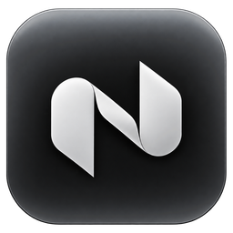

# Nook

**An animated island at the top of your Windows 11 screen.**

 

**[Download Nook for Windows 11](https://nook-download.vercel.app)**

v0.1.1 test build · free to evaluate · closed source

  

---

## What is Nook

Nook brings an animated, floating island to the top centre of Windows 11. It gathers live activities, system pop-ups, and control cards into one clean surface that sits quietly below the top edge of your screen. It stays out of your way until you need it, animates at your display's native refresh rate, and leaves your desktop fully clickable.

---

## Highlights

| Capability | Description |
|---|---|
| **Live activities** | Glanceable music with album accents, active calls, countdown timer, stopwatch, camera and microphone privacy indicators, and finished downloads. |
| **Quick pop-ups** | On-screen displays for volume, brightness, battery, Bluetooth with battery readout, Wi-Fi, Caps Lock, Num Lock, output device, and Night light. |
| **Expandable cards** | Scrollable card deck for Today, Timer, Stopwatch, Music controls, Calls, and Downloads. |
| **Several things at once** | A secondary activity detaches into a compact side pill connected by an organic liquid bridge. |
| **Three visibility modes** | Fixed, Smart, and Hidden modes adapt to your workflow and tuck away during fullscreen apps. |
| **Nook Flow** | Physics-based motion with selectable feels: Bouncy, Lively, or Smooth. |
| **Built to disappear** | Near-zero idle CPU, complete desktop click-through outside the pill, and clean exit restoring Windows defaults. |

---

## Live activities

Live activities keep ongoing tasks visible without covering your work. When an activity starts, the island expands from its resting clock to show real-time progress.

- **Music with album colours:** Shows the album artwork, track title, artist name, and live equaliser bars. The accent colour of the equaliser bars, seek bar, and subtle ambient glow adapts to match the album cover. Track changes peek open automatically. Hover reveals the track title, artist, and a play/pause button. Scrolling the mouse wheel over the music hover adjusts volume.
- **Calls:** Shows a green telephone glyph, live call duration, and real-time audio wave activity. Hover expands the view to display the active calling application and an instant mute button. When muted, the button and time switch to red.
- **Timer and stopwatch:** Independent live activities that can run simultaneously. The timer displays an orange countdown ring with the time remaining and pause/dismiss actions. The stopwatch tracks elapsed time in cyan with pause and reset controls.
- **Mic and camera privacy indicator:** Displays a prominent indicator whenever an application accesses your microphone (orange) or camera (green). Hover shows which application is accessing the hardware and provides a one-click mute button.
- **Downloads:** When a download finishes, displays a green checkmark with the file name and an "Open" button.

---

## Quick pop-ups

Nook replaces Windows' native flyouts with compact, responsive pop-ups that appear briefly at the top of the display and dismiss automatically.

- **Volume and brightness:** Smooth sliders with elastic drag past the limits and exact numeric readouts. Scrolling the mouse wheel over the island also adjusts volume directly. Muting shows a mute icon and dimmed bar.
- **Battery:** Shows current charge percentage, an animated sweep while charging, and a shake warning on low battery (20%) and critical battery (10%).
- **Bluetooth:** Shows the connected device name with real-time battery level (including individual headphone battery readouts).
- **Wi-Fi:** Confirms network connections and alerts you immediately when connection is lost.
- **Caps Lock and Num Lock:** Tactile on-screen pills confirm toggle states (On / Off) without interrupting typing.
- **Screenshots and clipboard:** Displays a capsule thumbnail preview whenever a screen capture is taken or text is copied.
- **Output device:** Confirms audio output switching between headphones, speakers, and external displays.
- **Night light:** Confirms display temperature shifts on scheduled or manual triggers.

---

## Cards

Clicking the island expands it into a deck of cards. Turn the mouse wheel over the open card to scroll smoothly between views.

- **Today:** Displays the current day, date, large time, and local weather ("24° Sunny").
- **Timer:** Provides a countdown dial, remaining time, preset duration targets, and pause/cancel buttons.
- **Stopwatch:** High-precision lap and split counter in cyan with lap timing and reset controls.
- **Music:** Full album artwork, song title, artist, scrubbable seek bar with elapsed and remaining times, audio output switcher, and previous, play/pause, and next controls.
- **Call:** Active application name, live call duration, mute microphone, audio output switcher, and open call window buttons.
- **Download:** Displays the finished file name, file size, "Show in folder", and "Open" buttons.

---

## Several things at once: the side pill

When two live activities run at the same time—such as an active call while a countdown timer is running—Nook does not compromise either activity.

The primary activity occupies the main island. The secondary activity detaches into a compact side pill to the right, connected at separation by an organic liquid bridge. The side pill displays live values (such as countdown digits or equaliser waves). Clicking either pill instantly swaps their positions.

---

## Visibility modes

Choose how Nook behaves across your daily desktop workflow:

- **Smart** (Default): The idle pill stays visible over the desktop and windowed applications. When an application is maximized, the pill tucks away so it never covers window titlebars, address fields, or browser tabs. Resting the cursor at the top-centre display edge slides the compact pill down into view. Live activities (calls, timers, privacy alerts, and finished downloads) remain visible in compact form even when apps are maximized.
- **Fixed:** The island remains anchored at the top centre of your display at all times across all windows.
- **Hidden:** The island remains hidden at all times until you summon it by resting the cursor at the top-centre display edge.

### Fullscreen awareness

In all modes, Nook automatically hides during fullscreen games, videos, and presentations. An optional setting allows active calls and camera/microphone privacy indicators to remain visible during fullscreen sessions.

---

## Make it yours

Left-click the Nook icon in the Windows system tray to open Settings at any time (the tray menu also offers Settings and Quit Nook; there is no right-click on the island itself).

- **Defaults for new users:** Out of the box, Nook starts in Smart visibility mode, with a Tinted pill background, Translucent surface at 70% opacity, Bouncy motion feel, and all live activities enabled.
- **Live wallpaper preview:** The settings window includes an interactive preview of the island rendered directly over your desktop wallpaper. Every toggle and slider updates the preview in real time.
- **Motion feel:** Choose the spring physics preset that matches your setup:
  - **Bouncy** (Default): Playful elastic momentum with noticeable bounce on size changes.
  - **Lively**: Faster spring response with crisp overshoots and quick settling.
  - **Smooth**: Restrained, fluid transitions tuned for a calm desktop presence.
- **Appearance:** Choose Solid or Translucent surface styling, adjust opacity from 60% to 100%, and select a pill background option (Pure black, Edge + shadow, or Tinted edge with activity colour).
- **Weather by city:** Local weather powered by MET Norway with city geocoding. Enter any city name to receive current conditions and temperature on your Today card.
- **Display options:** Place the island on your Main display or on the Display with the cursor.

---

## Built to disappear

A desktop accessory must never compromise system performance or break your desktop:

- **Display refresh rate:** Nook renders smoothly at your display's native refresh rate—whether 60 Hz, 120 Hz, 144 Hz, or 240 Hz—without resizing the window.
- **Near-zero idle CPU:** When sitting idle at the screen edge, Nook consumes essentially 0% CPU. Cursor tracking stays lightweight and gentle on system resources.
- **Click-through outside the pill:** The window canvas outside the pill is completely transparent and passes all cursor clicks directly to the windows and desktop below.
- **Clean exit:** Quitting Nook cleanly restores Windows' native volume pop-up.

---

## Requirements

- **Operating System:** Windows 11 (64-bit, Version 21H2 / Build 22000 or higher). Windows 10 is not supported.
- **Runtime:** Microsoft Edge WebView2 Evergreen Runtime (pre-installed on all Windows 11 systems).
- **Architecture:** x86_64.

---

## Install

1. Download the latest installer from the official download page:
   **[https://nook-download.vercel.app](https://nook-download.vercel.app)**
2. Run `Nook_0.1.1_x64-setup.exe`. The installer sets up Nook in your user profile.
3. **Windows SmartScreen note:** This evaluation test build is not yet signed with a commercial code-signing certificate. When Windows SmartScreen displays *"Windows protected your PC"*, click **More info**, then click **Run anyway**.
4. **Windows Defender note:** Because this test build is new and unsigned, Defender can wrongly remove it. The installer therefore asks once, before installing, to allow the Nook folder through Defender. Windows shows its normal permission prompt. Choose **No** to cancel the installation. See [TESTING.md](TESTING.md) for how to restore Nook if Defender removes it anyway.
5. Nook launches immediately and places the resting pill at the top centre of your screen. Access settings at any time by clicking the Nook icon in the Windows system tray (or right-click for the tray menu with Settings and Quit Nook).

---

## Report a problem

If you encounter an issue or have feedback on the test build:

1. Check existing reports on the [GitHub Issues](https://github.com/adarzhpathade/nook-releases/issues) page.
2. Open a new issue using the provided issue template. Please include your Windows 11 build number, display refresh rate, and multi-monitor setup if applicable.

---

## Roadmap

The following capabilities are planned for upcoming releases (not available in the current v0.1.1 test build):

- [ ] Commercial code signing certificate (removes the SmartScreen prompt)
- [ ] Automatic background updates
- [ ] License key activation
- [ ] Custom sound effects
- [ ] Island notifications

---

## Credits

Developed by **[Adarzh](https://adrz-26.vercel.app/)**.

---

## License

Nook is proprietary software provided as a free evaluation test build. See [`LICENSE.txt`](LICENSE.txt) for license terms and restrictions.
